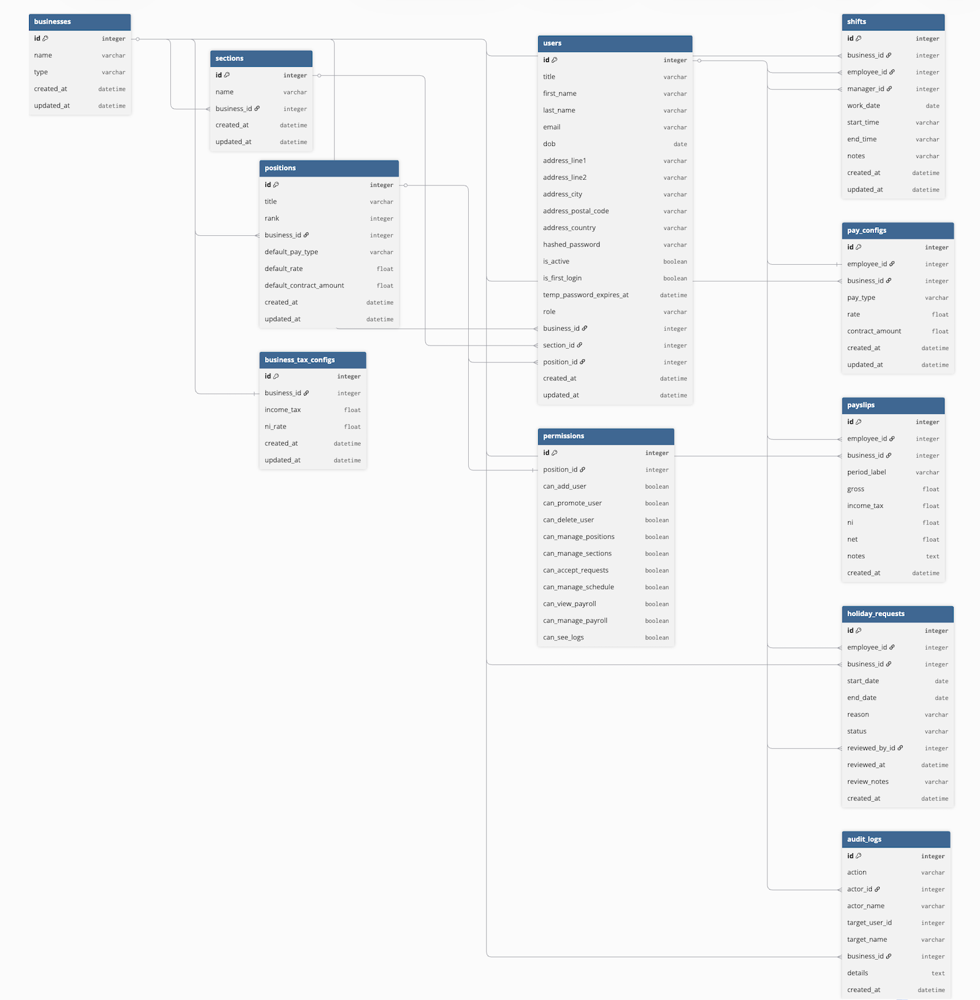

# EMS Backend
REST API for Employee Management System (EMS) built with FastAPI, SQLAlchemy, and SQLite (with further support for MySQL).

## Requirements
- Python 3.13 or higher
- FastAPI
- SQLAlchemy
- SQLite
- JWT for authentication
- uv package manager
- pytest for testing

## Structure
```
backend/
├── app/
│   ├── core/
│   ├── models/
│   ├── routers/
│   ├── schemas/
│   ├── services/
│   └── main.py
├── scripts/
│   └── seed_admin.py
├── tests/
├── Dockerfile
├── docker-compose.yml
├── pyproject.toml
├── .env
├── .gitignore
└── README.md
```

## Features
- JWT-based authentication with access and refresh tokens
- Role-based access control: `admin`, `manager`, `employee`
- Granular manager permissions per position (schedule, payroll, logs, requests)
- First-login temporary password flow with enforced password change
- Business, section, and position management
- Shift scheduling with manager assignment
- Payroll engine: pay configs, tax configs, payslip generation (salary & hourly)
- Holiday request submission and manager review workflow
- Full audit logging on all mutating actions
- Background email notifications (welcome email on manager creation)
- Auto table creation on startup via SQLAlchemy lifespan (no migrations needed)

## Setup

### Local (uv)

```bash
# Clone the repo and enter the backend directory
cd backend

# Create virtual environment and install dependencies
uv sync

# Seed the first admin account
uv run python scripts/seed_admin.py

# Start the server
uv run uvicorn app.main:app --reload
```

API is available at `http://localhost:8000`  
Interactive docs at `http://localhost:8000/docs`

## Environment Variables

Create a `.env` file in the `backend/` directory:

```env
APP_NAME=EMS API
APP_VERSION=1.0.0

SECRET_KEY=your-secret-key-here
ALGORITHM=HS256
ACCESS_TOKEN_EXPIRE_MINUTES=30
REFRESH_TOKEN_EXPIRE_DAYS=7

DATABASE_URL=sqlite:///./ems.db

MAIL_USERNAME=your@email.com
MAIL_PASSWORD=your-email-password
MAIL_FROM=your@email.com
MAIL_SERVER=smtp.gmail.com
MAIL_PORT=587

MAX_ADMINS=3
```

## API Endpoints

All protected routes require `Authorization: Bearer <token>` header.

### Auth
| Method | Endpoint | Description |
|--------|----------|-------------|
| `POST` | `/auth/login` | Login, returns access + refresh tokens |
| `POST` | `/auth/change-password` | Change own password |
| `GET`  | `/auth/me` | Get current authenticated user |

### Users
| Method  | Endpoint   | Description |
|---------|------------|-------------|
| `GET`   | `/users/me` | Get own profile |
| `PATCH` | `/users/me` | Update own profile / address |

### Admin
| Method   | Endpoint | Description | Access |
|----------|----------|-------------|--------|
| `GET`    | `/admin/users` | List all users | Admin |
| `POST`   | `/admin/managers` | Create manager account (sends welcome email) | Admin |
| `GET`    | `/admin/users/{id}` | Get user by ID | Admin |
| `PATCH`  | `/admin/users/{id}` | Update any user | Admin |
| `DELETE` | `/admin/users/{id}` | Delete user | Admin |
| `POST`   | `/admin/users/{id}/promote` | Change role + position | Admin |

### Business
| Method   | Endpoint | Description | Access |
|----------|----------|-------------|--------|
| `GET`    | `/business` | List all businesses | All |
| `POST`   | `/business` | Create business | Admin |
| `GET`    | `/business/{id}` | Get business | All |
| `PATCH`  | `/business/{id}` | Update business | Admin |
| `DELETE` | `/business/{id}` | Delete business | Admin |
| `GET`    | `/business/{id}/sections` | List sections | All |
| `POST`   | `/business/{id}/sections` | Add section | Admin |
| `PATCH`  | `/business/{id}/sections/{section_id}` | Update section | Admin |
| `DELETE` | `/business/{id}/sections/{section_id}` | Delete section | Admin |

### Positions
| Method   | Endpoint | Description | Access |
|----------|----------|-------------|--------|
| `GET`    | `/positions` | List positions (filter: `?business_id=`) | All |
| `POST`   | `/positions` | Create position with permissions | Admin |
| `GET`    | `/positions/{id}` | Get position | All |
| `PATCH`  | `/positions/{id}` | Update position + permissions | Admin |
| `DELETE` | `/positions/{id}` | Delete position | Admin |

### Schedule
| Method   | Endpoint | Description | Access |
|----------|----------|-------------|--------|
| `GET`    | `/schedule` | List shifts (filter: `?employee_id=&date_from=&date_to=`) | All |
| `POST`   | `/schedule` | Create shift | Admin / Manager (`can_manage_schedule`) |
| `DELETE` | `/schedule/{id}` | Delete shift | Admin / Manager (`can_manage_schedule`) |

### Payroll
| Method | Endpoint | Description | Access |
|--------|----------|-------------|--------|
| `GET`  | `/payroll/tax-config` | Get tax config for a business | Admin / Manager (`can_manage_payroll`) |
| `POST` | `/payroll/tax-config` | Create or update tax config | Admin / Manager (`can_manage_payroll`) |
| `GET`  | `/payroll/pay-config` | List pay configs | Admin / Manager (`can_manage_payroll`) |
| `POST` | `/payroll/pay-config` | Create pay config | Admin / Manager (`can_manage_payroll`) |
| `GET`  | `/payroll/payslips` | List payslips (employees see own only) | All |
| `POST` | `/payroll/payslips` | Generate payslip for a period | Admin / Manager (`can_manage_payroll`) |

### Holidays
| Method | Endpoint | Description | Access |
|--------|----------|-------------|--------|
| `GET`  | `/holidays` | List requests (filter: `?status=&employee_id=`) | All |
| `POST` | `/holidays` | Submit holiday request | All |
| `POST` | `/holidays/{id}/review` | Approve or reject request | Admin / Manager (`can_accept_requests`) |

### Logs
| Method | Endpoint | Description | Access |
|--------|----------|-------------|--------|
| `GET` | `/logs` | List audit logs (filter: `?business_id=&action=&actor_id=&limit=`) | Admin / Manager (`can_see_logs`) |
| `GET` | `/logs/{id}` | Get single log entry | Admin / Manager (`can_see_logs`) |

### Health
| Method | Endpoint | Description |
|--------|----------|-------------|
| `GET` | `/health` | Health check, returns version |

## Security
- Passwords are hashed using **Argon2** for secure storage.
- **JWT** is used for authentication, with access tokens expiring after 30 minutes.
- New accounts receive a **temporary password** that must be changed on first login.
- Password requirements:
  - Minimum 8 characters
  - At least one uppercase letter
  - At least one lowercase letter
  - At least one digit
  - At least one special character
- Secret keys and sensitive configuration are stored in environment variables.

## Security Tests
- Unit tests for password hashing and verification.
- Tests for JWT token generation and validation.
- Tests for password strength validation.

## Running Tests

```bash
uv run pytest                          # run all tests
uv run pytest -v                       # verbose output
uv run pytest tests/test_auth.py       # single file
```

## Database Schema

The ERD for the EMS backend includes the following tables:

### Tables
| Name                   | Description                                                                     |
|------------------------|---------------------------------------------------------------------------------|
| `users`                | Stores user information, including username, email, hashed password, role, etc. |
| `businesses`           | Top level entity representing a business.                                       |
| `sections`             | Represents different sections within a business (e.g., HR, IT, Sales).         |
| `positions`            | Represents different positions within a section (e.g., Manager, Developer).    |
| `permissions`          | Stores permissions for different roles (e.g., Admin, Manager, Employee).       |
| `shifts`               | Represents work shifts for employees.                                           |
| `pay_configs`          | Stores pay configuration for different positions.                               |
| `business_tax_configs` | Stores tax and NI configuration for different businesses.                       |
| `payslips`             | Generated payslips for employees based on their shifts and pay configuration.   |
| `holiday_requests`     | Stores holiday requests made by employees.                                      |
| `audit_logs`           | Logs of important actions for auditing purposes.                                |

### Relationships
- A `User` belongs to one `Business` and can have one `Position` and one `Section`.
- A `Position` has a set of `Permissions`.
- A `Business` has many `Sections`, `Positions`, and `Users`.
- A `User` has one `PayConfig` and many `Payslips`, `Shifts`, and `HolidayRequests`.
- An `AuditLog` is associated with a `User` and records actions taken by that user.


